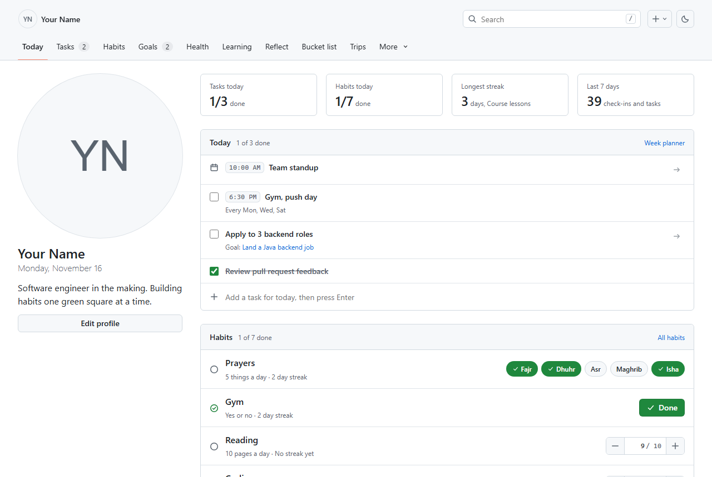
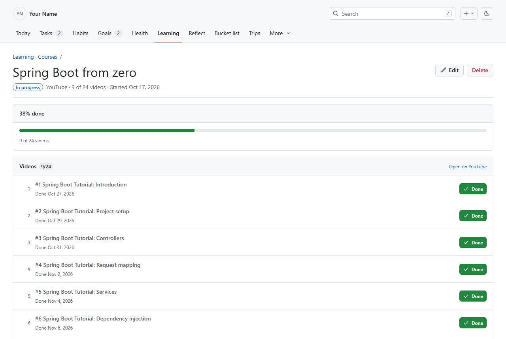
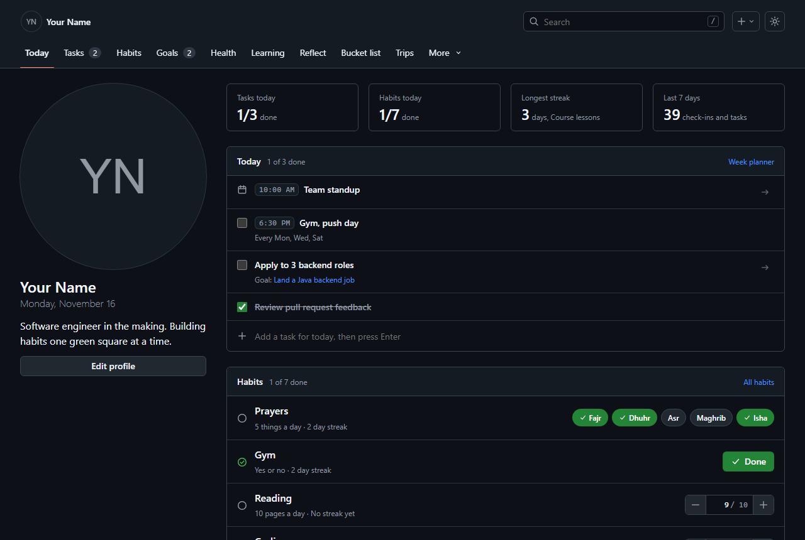

# habit_tracker

**Your whole life on one green grid.** Habits, tasks, goals, workouts, courses and reflections in a private dashboard that looks and feels like GitHub, and runs entirely on your own computer.

Every check-in, finished task and reached milestone becomes a square on a contribution grid. Watch the squares turn green, keep your streaks alive, and see how close you are to every goal.



---

## Why habit_tracker?

- **One place for everything.** No more jumping between a habit app, a to-do app, a notes app and a spreadsheet.
- **Private by design.** Your data lives in a single file on your computer. No account, no cloud, no tracking.
- **Motivating, not noisy.** A calm, familiar GitHub-style look, with green squares that reward showing up every day.
- **Zero setup.** No database and no `npm install`. Just Node.js and a double-click.

---

## Features

### Daily
| | |
|---|---|
| **Today** | Your profile, today's tasks and events, habit check-ins, goals in progress, a year-long contribution grid and an activity feed. |
| **Habits** | Yes/no habits, number habits ("8 glasses of water") and checklists ("5 daily prayers"), with streaks and a grid for each habit. |
| **Tasks** | A week planner with drag and drop, repeating tasks (daily, weekly, monthly, chosen days), events with times, and an overdue list. |

### Growth
| | |
|---|---|
| **Goals** | Break goals into milestones with due dates. Progress fills in by itself, and every goal says if you are **On track**, **Behind** or **Overdue**. |
| **Learning** | Paste a YouTube playlist and get every video as a checklist. Track books by page, courses by lesson, and coding time with a weekly chart. |
| **Focus timer** | Start a coding session (25, 45, 60 or 90 minutes, or Pomodoro). Each minute fills a square, and a soft chime marks the end. |
| **Health** | Log your weight with a trend chart, and workouts with sets, reps and weights. See your strength go up per exercise. |

### Reflection and more
| | |
|---|---|
| **Reflect** | Quick daily notes with a mood, and a weekly review that sums up your week for you. Your focus for next week shows on Today. |
| **Trips** | Upcoming and past trips with photos and a reusable packing list. |
| **Bucket list, Projects, Wishlist** | Turn a bucket-list dream into a goal in one click. Track projects and DIY builds, and keep a list of things you want. |

### Built in
- **Linked sections.** A workout ticks your Gym habit, coding time adds to your Coding habit, and every video you finish counts toward your Course lessons.
- **Light and dark mode**, with one click.
- **Works on your phone's screen size**, with a bottom tab bar and big touch targets.
- **Search everything** (press <kbd>/</kbd>).
- **Backups**: a copy before every change, a daily copy to any folder you choose (OneDrive works great), one-click download and restore.

---

## Screenshots

| Habits with streaks | A goal with milestones |
|---|---|
|  |  |

| Course from a YouTube playlist | Focus timer |
|---|---|
|  |  |

**Dark mode**



*All screenshots use made-up demo data.*

---

## Get started

### What you need
- **[Node.js](https://nodejs.org) 18 or newer.** That is the only requirement.

### Run it (Windows)
1. Download this project: click **Code → Download ZIP** and unzip it, or run:
   ```bash
   git clone https://github.com/ahmedshendyyyz-dev/habit_tracker.git
   ```
2. Double-click **`Start habit_tracker.bat`**.
3. Your browser opens at **http://127.0.0.1:4173**. Keep the small window open while you use the app, and close it when you are done.

### Run it (macOS or Linux)
```bash
cd habit_tracker
LIFE_NO_OPEN=1 node server.js
```
Then open **http://127.0.0.1:4173** in your browser.

### Your first five minutes
1. Click **Edit profile** on Today and add your name and photo.
2. Open **Habits** and press **Add starter habits**, or create your own.
3. Add a goal, give it a few milestones, and watch its progress bar move.
4. Type a task into **Add a task for today** and press Enter.
5. Come back tomorrow and tick things off. That is how the grid turns green.

---

## Your data

Everything you enter is saved in the `data` folder next to the app:

```
data/
├── life-data.json   all your entries, in one readable file
├── photos/          photos you add
└── backups/         automatic daily copies, kept for 90 days
```

- The app only listens on your own computer (`127.0.0.1`). Other devices and websites cannot reach it.
- The `data` folder is listed in `.gitignore`, so it never ends up on GitHub.
- Open **More → Settings** to download your data, restore any backup, or copy everything to another folder every day.

---

## How it is built

Plain, dependency-free code that is easy to read and change.

- **Server:** one Node.js file (`server.js`) using only built-in modules. It serves the app, saves your data safely (write to a temporary file, then swap), and keeps backups.
- **App:** plain JavaScript modules, HTML and CSS. No framework and no build step.
- **Data:** one JSON file. Pages share a single in-memory copy, so moving between pages is instant.
- **Syncing:** if the app is open in two places, each save is checked against the latest version, and changes from elsewhere show up within 30 seconds.

```
habit_tracker/
├── server.js              local server: files, saving, backups, restore
├── youtube.js             reads video names from a public YouTube playlist
├── Start habit_tracker.bat
└── public/
    ├── index.html
    ├── css/styles.css     the GitHub-style look, light and dark
    └── js/
        ├── app.js         top bar, tabs, syncing, midnight rollover
        ├── store.js       loading and saving
        ├── schema.js      every section and its fields
        ├── views.js       pages and routing
        ├── grid.js        the contribution grid
        └── ...            one file per section (tasks, habits, goals, health, learning)
```

---

## Good to know

- **YouTube playlists** are read from the public playlist page, without an API key. If YouTube changes that page, fetching new playlists may stop working until the reader is updated. Courses you already added keep working. Only the first 100 videos of a playlist are fetched.
- **The focus timer** remembers a running session in your browser, so a session started on one device does not appear on another. The saved result does.
- **Weeks start on Saturday** in the planner and weekly review.

---

## Roadmap

- [ ] Open the app on your phone from anywhere (private network with Tailscale)
- [ ] Phone reminders for tasks, habits and deadlines
- [ ] Google Calendar events in the week planner
- [ ] Undo for quick actions, and archiving old habits and goals

---

Made with care, one green square at a time.
