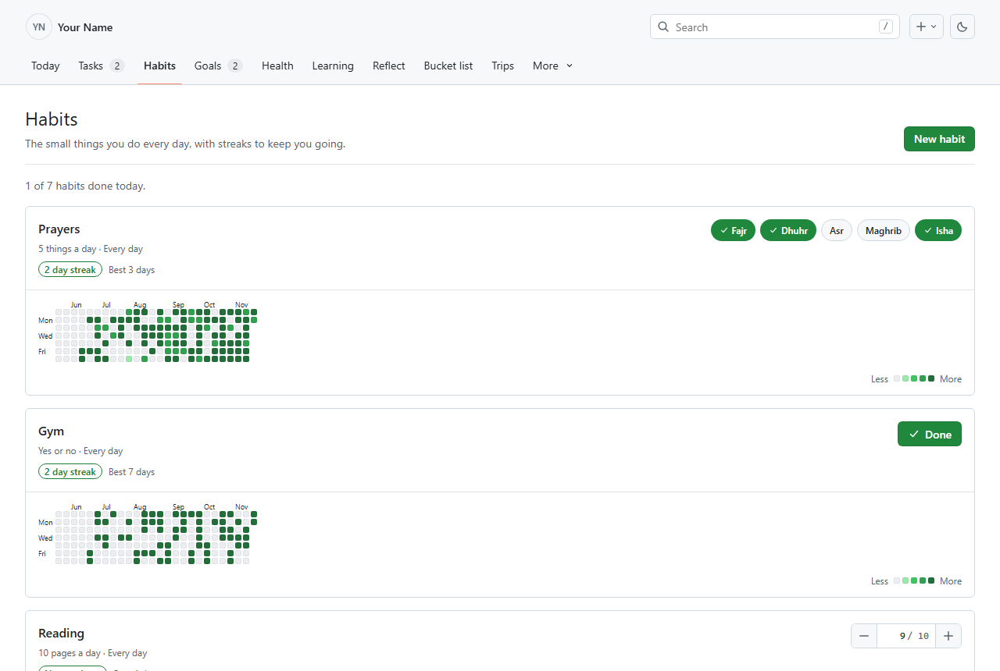
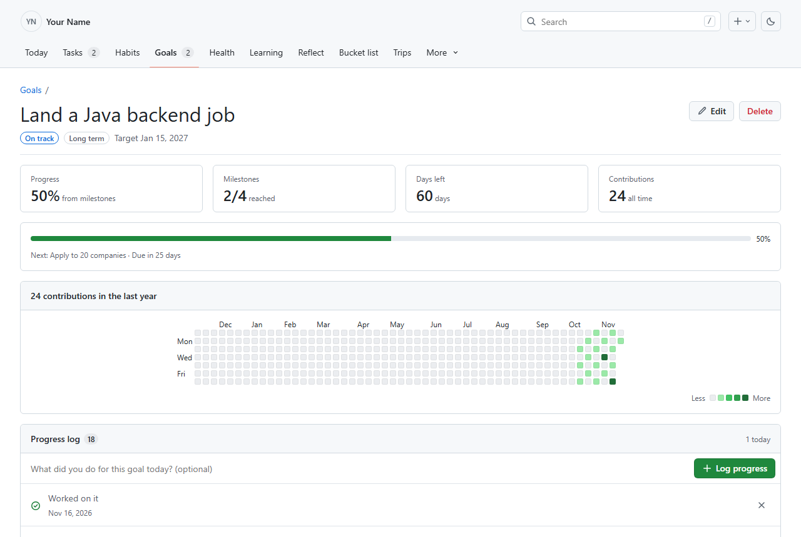
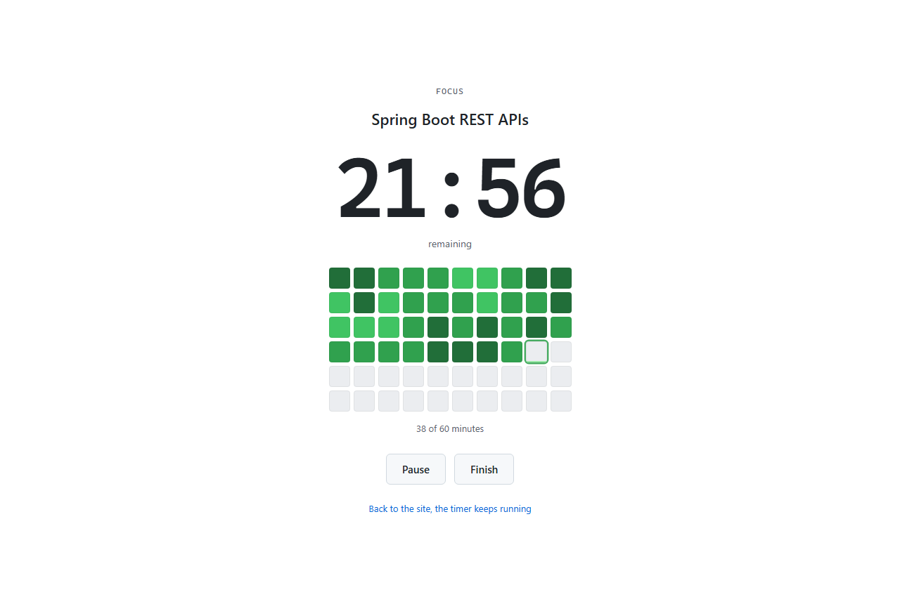

# habit_tracker

**Your whole life on one green grid.** Habits, tasks, goals, workouts, courses and reflections in a private dashboard that looks and feels like GitHub, on your phone and your computer.

Every check-in, finished task and reached milestone becomes a square on a contribution grid. Watch the squares turn green, keep your streaks alive, and see how close you are to every goal.


---

## Why habit_tracker?

- **One place for everything.** No more jumping between a habit app, a to-do app, a notes app and a spreadsheet.
- **Same data on every device.** Tick a habit on your phone and it is there on your laptop, within seconds.
- **Private by design.** Your entries and photos are locked to your own account. Nobody else can sign up or see them.
- **Motivating, not noisy.** A calm, familiar GitHub-style look, with green squares that reward showing up every day.
- **Free to run.** Hosted on GitHub Pages, with data in a free Supabase project.

---

## Features

### Daily
| | |
|---|---|
| **Today** | Your profile, today's tasks and events, habit check-ins, goals in progress, a year-long contribution grid and an activity feed. |
| **Habits** | Yes/no habits, number habits ("8 glasses of water") and checklists ("5 daily prayers"), with streaks and a grid for each habit. |
| **Tasks** | A week planner with drag and drop, repeating tasks (daily, weekly, monthly, chosen days), events with times, and an overdue list. |

### Growth
| | |
|---|---|
| **Goals** | Break goals into milestones with due dates. Progress fills in by itself, and every goal says if you are **On track**, **Behind** or **Overdue**. |
| **Learning** | Paste a YouTube playlist and get every video as a checklist. Track books by page, courses by lesson, and coding time with a weekly chart. |
| **Focus timer** | Start a coding session (25, 45, 60 or 90 minutes, or Pomodoro). Each minute fills a square, and a soft chime marks the end. |
| **Health** | Log your weight with a trend chart, and workouts with sets, reps and weights. See your strength go up per exercise. |

### Reflection and more
| | |
|---|---|
| **Reflect** | Quick daily notes with a mood, and a weekly review that sums up your week for you. Your focus for next week shows on Today. |
| **Trips** | Upcoming and past trips with photos and a reusable packing list. |
| **Bucket list, Projects, Wishlist** | Turn a bucket-list dream into a goal in one click. Track projects and DIY builds, and keep a list of things you want. |

### Reminders
| | |
|---|---|
| **Morning summary** | "3 tasks today, 1 overdue, 1 event", plus any milestones due tomorrow or running late. |
| **Events** | A heads-up before anything with a time, 15 minutes by default. |
| **Habit nudge** | In the evening, the habits you have not finished yet: "Water 1/3, Reading 0/10". |
| **Weekly review** | A reminder on the day you choose, only if you have not written it yet. |
| **Prayer times** | Worked out every day for your city (Egyptian General Authority of Survey method), with a reminder before and at each prayer. Nudge any prayer by a few minutes to match your mosque. |

Reminders arrive as real notifications on your phone and computer, even when the app is closed. Choose which ones you want and when in **Settings → Notifications**.

### Built in
- **Install it like an app** on Android, iPhone, Windows or Mac, with its own icon and full screen.
- **Linked sections.** A workout ticks your Gym habit, coding time adds to your Coding habit, and every video you finish counts toward your Course lessons.
- **Light and dark mode**, with one click.
- **Made for phones too**, with a bottom tab bar and big touch targets.
- **Search everything** (press <kbd>/</kbd>).
- **Backups**: a copy of your data from the start of every day (kept 90 days), one-click download, and restore.

---

## Screenshots

| Habits with streaks | A goal with milestones |
|---|---|
|  |  |

| Course from a YouTube playlist | Focus timer |
|---|---|
|  |  |

**Dark mode**


*All screenshots use made-up demo data.*

---

## Using it

1. Open the app's address in Chrome, Edge or Safari, on any device.
2. Sign in with your email and password.
3. Install it: on a phone, **⋮ → Install app** (Android) or **Share → Add to Home Screen** (iPhone). On a computer, click the install icon in the address bar.

That's it. Everything you do is saved straight away and shows up on your other devices within 30 seconds, or as soon as you switch back to the app.

To get reminders, open **More → Settings → Notifications** on each device, press **Turn on for this device**, and allow notifications. **Send a test** checks that it works.

### Your first five minutes
1. Click **Edit profile** on Today and add your name and photo.
2. Open **Habits** and press **Add starter habits**, or create your own.
3. Add a goal, give it a few milestones, and watch its progress bar move.
4. Type a task into **Add a task for today** and press Enter.
5. Come back tomorrow and tick things off. That is how the grid turns green.

---

## Set up your own copy

habit_tracker is a personal app: each copy belongs to one person, and sign-ups are switched off. To run your own, you need a free **[Supabase](https://supabase.com)** account and a **GitHub** account. It takes about 15 minutes, with no coding.

1. **Fork or copy this repository** to your GitHub account.
2. **Create a Supabase project.** Pick the region closest to you, and keep the Data API turned on.
3. **Create the database.** In Supabase, open **SQL Editor**, paste in [`supabase/setup.sql`](supabase/setup.sql) and click **Run**.
4. **Create your account.** Go to **Authentication → Users → Add user** and tick **Auto Confirm User**. Then, under **Authentication → Sign In / Providers**, turn off **Allow new users to sign up**.
5. **Add the playlist reader.** Go to **Edge Functions → Deploy a new function → Via Editor**, name it `playlist`, and paste in [`supabase/functions/playlist/index.ts`](supabase/functions/playlist/index.ts).
6. **Connect the app to your project.** In [`public/js/config.js`](public/js/config.js), put your **Project URL** and **publishable key** (from **Project Settings → API**). Never put the secret or `service_role` key there.
7. **Publish it.** In your repository, go to **Settings → Pages → Source** and choose **GitHub Actions**. Every push to `main` now publishes the app to `https://YOUR-NAME.github.io/habit_tracker/`.

### Optional: phone notifications
8. **Make your notification keys.** Run this once with [Node.js](https://nodejs.org) and keep the output private:
   ```bash
   node -e "const c=require('crypto');const k=c.generateKeyPairSync('ec',{namedCurve:'prime256v1'}).privateKey.export({format:'jwk'});console.log('VAPID_PUBLIC_KEY='+Buffer.concat([Buffer.from([4]),Buffer.from(k.x,'base64url'),Buffer.from(k.y,'base64url')]).toString('base64url'));console.log('VAPID_PRIVATE_KEY='+k.d);console.log('CRON_SECRET='+c.randomBytes(24).toString('base64url'))"
   ```
   Put the **public** key in `public/js/config.js` as `VAPID_PUBLIC_KEY`.
9. **Add the tables.** Run [`supabase/notifications.sql`](supabase/notifications.sql) in the SQL Editor.
10. **Add the sender.** In **Edge Functions → Secrets**, add `VAPID_PUBLIC_KEY`, `VAPID_PRIVATE_KEY` and `CRON_SECRET`. Then deploy [`supabase/functions/notify/index.ts`](supabase/functions/notify/index.ts) as a function named `notify`, with **Verify JWT turned off**. It checks the secret and your login itself.
11. **Start the schedule.** In [`supabase/notifications-cron.sql`](supabase/notifications-cron.sql), fill in your project and your `CRON_SECRET`, then run it. The sender now checks every 5 minutes for reminders that are due.

The private key and the cron secret are passwords: keep them only in Supabase's secrets, never in the code.

---

## Your data and privacy

- **Where it lives:** in your own Supabase project. Your entries are one private document, and your photos sit in a private storage folder.
- **Who can see it:** only you. The database checks your login on every read and write, and sign-ups are off, so no one else can create an account.
- **The public key is public on purpose.** `config.js` holds the project URL and the publishable key, which are designed to be visible. Your data is protected by your login and the database's access rules, not by hiding that key.
- **Two devices, one truth:** each save checks it is building on the latest version, so the phone and the computer never overwrite each other.
- **Backups:** a copy from the start of each day for 90 days, plus one before every restore. In **More → Settings** you can download everything as a file or restore any copy.

---

## How it is built

Plain, dependency-light code that is easy to read and change.

- **App:** plain JavaScript modules, HTML and CSS. No framework and no build step. It is a static site, hosted on GitHub Pages.
- **Data:** Supabase Postgres, with access rules and two small database functions for saving and restoring. All your data is one JSON document, and pages share one in-memory copy, so moving around is instant.
- **Photos:** Supabase Storage, shown through private links that are made fresh each time the app opens.
- **YouTube playlists:** a Supabase Edge Function reads the public playlist page and checks you are signed in.
- **Notifications:** Supabase Cron runs a second Edge Function every 5 minutes. It works out what is due from your data, sends standard Web Push notifications (encrypted and signed with the browser's built-in Web Crypto, no libraries), and remembers what it sent so nothing arrives twice.
- **Prayer times:** calculated from the sun's position in a few dozen lines of code, so there is no outside service to depend on.
- **Installable:** a web app manifest and a small service worker. It always loads the latest version, and only keeps a fallback copy of the app's files, never your data.

```
habit_tracker/
├── public/                  the app, published to GitHub Pages
│   ├── index.html
│   ├── manifest.webmanifest app name and icons, for installing
│   ├── sw.js                makes it installable
│   ├── css/styles.css       the GitHub-style look, light and dark
│   └── js/
│       ├── config.js        your Supabase project URL and public key
│       ├── backend.js       talks to Supabase (or the local test server)
│       ├── store.js         loading, saving and syncing
│       ├── schema.js        every section and its fields
│       ├── app.js           sign-in, top bar, tabs, midnight rollover
│       ├── grid.js          the contribution grid
│       ├── prayer.js        prayer times for any day and city
│       ├── notifyView.js    Settings → Notifications
│       └── ...              one file per section (tasks, habits, goals, health, learning)
├── supabase/
│   ├── setup.sql            tables, access rules, save and restore functions, photo storage
│   ├── notifications.sql    notification settings, devices, and what was sent
│   ├── notifications-cron.sql   the every-5-minutes schedule (a template)
│   └── functions/
│       ├── playlist/        the YouTube playlist reader
│       └── notify/          sends your reminders
├── .github/workflows/       publishes the app on every push
└── server.js                optional local server, for testing on a copy of your data
```

### Testing without touching your real data
Run `node server.js` (needs [Node.js](https://nodejs.org) 18+) and open **http://127.0.0.1:4173/?local**. The `?local` switch makes the app use a `data` folder on your computer instead of Supabase. That folder is listed in `.gitignore`, so it never ends up on GitHub.

---

## Good to know

- **YouTube playlists** are read from the public playlist page, without an API key. If YouTube changes that page, fetching new playlists may stop working until the reader is updated. Courses you already added keep working. Only the first 100 videos of a playlist are fetched.
- **The focus timer** remembers a running session on the device you started it on. The saved result appears everywhere.
- **Notifications** need the app installed on iPhone (Add to Home Screen). On Android they work from Chrome, installed or not. A reminder can arrive up to 5 minutes after its time, since the sender runs every 5 minutes.
- **Prayer times** are set for Cairo. For another city, change its latitude, longitude and time zone in `public/js/prayer.js` (`CAIRO`) and in `supabase/functions/notify/index.ts` (`DEFAULT_PREFS.place`).
- **Weeks start on Saturday** in the planner and weekly review.
- **Supabase's free plan** pauses a project after a week with no use. Using the app regularly keeps it awake, and a paused project can be resumed from the Supabase dashboard.

---

## Roadmap

- [x] Same data on phone and computer, installable as an app
- [x] Phone reminders for tasks, habits, milestones, the weekly review and prayer times
- [ ] Google Calendar events in the week planner
- [ ] Undo for quick actions, and archiving old habits and goals

---

Made with care, one green square at a time.
